# מדריך למשתמש: עלוני שבת

עלוני שבת מכמה אתרים במקום אחד, בתוך אוצריא: חיפוש מיידי, עיון לפי שבוע וסדרה, קריאה והדפסה,
מעקב אחרי סדרות והורדה לקריאה גם בלי רשת. התוסף אינו שולח דבר לשום מקום: ההיסטוריה, החיפושים
והרשימות נשארים אצלכם.

צילומי המסך נוצרו מהתוסף עצמו (`node tools/preview/screenshots.mjs`) על נתוני דוגמה.

## השבוע

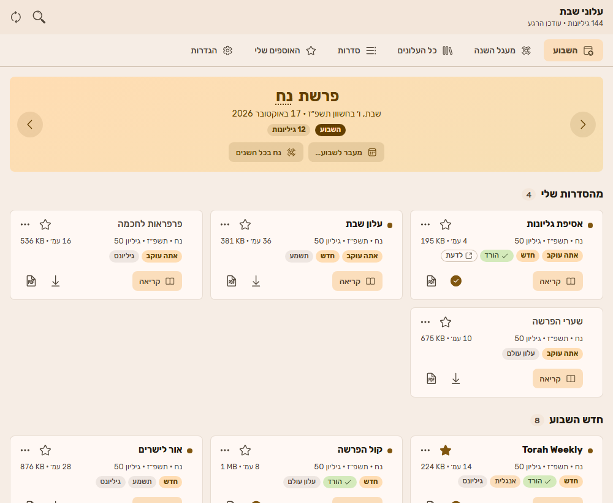

המסך הראשון מציג את **השבת הקרובה** לפי התאריך של היום (או חג שקודם לה), עם התאריך העברי והלועזי:
"שבת, ו׳ בחשוון תשפ״ז · 17 באוקטובר 2026". מתחת: העלונים מהסדרות שאתם עוקבים אחריהן, חדשים
השבוע, והמשך קריאה. בלחיצה על גיליון אפשר לקרוא אותו מיד.

- **חצים** עוברים לשבוע הקודם או הבא, כולל חגים שחלים באמצע השבוע (פורים, פסח, ראש חודש…).
- **"מעבר לשבוע…"** פותח בורר: בוחרים שנה עברית ורואים את כל הפרשות, השבתות המיוחדות והחגים שלה, עם
  מספר העלונים בכל אחד; או מזינים תאריך לועזי או עברי. "טעינת שנים ישנות" מוסיפה את לוח השנים
  הקודמות.
- כשמוצג שבוע שאינו הנוכחי הכותרת אומרת זאת ("בעוד 22 שבועות") ויש "חזרה להשבוע".
- בהגדרות (כללי) בוחרים פרשות לפי ארץ ישראל או חוץ לארץ; בשבת שחל בה חג בחו"ל בלבד, בארץ היא שבת רגילה.

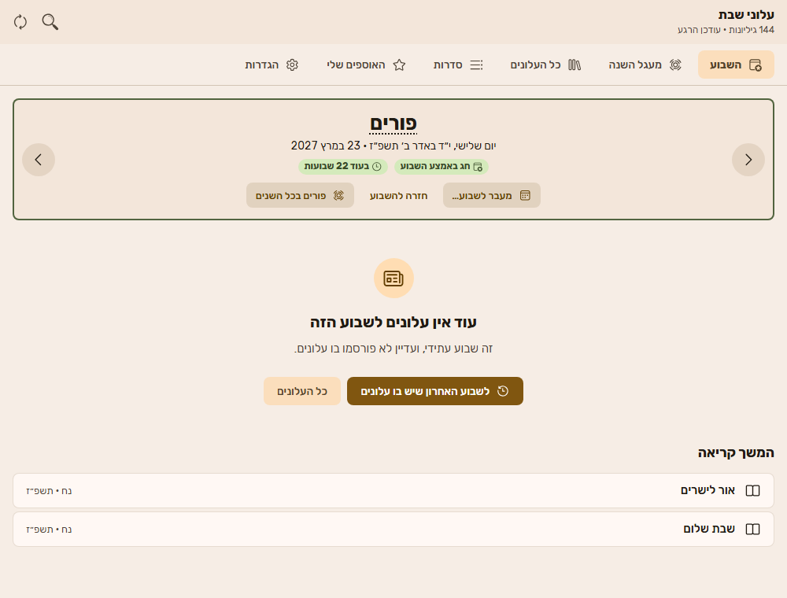

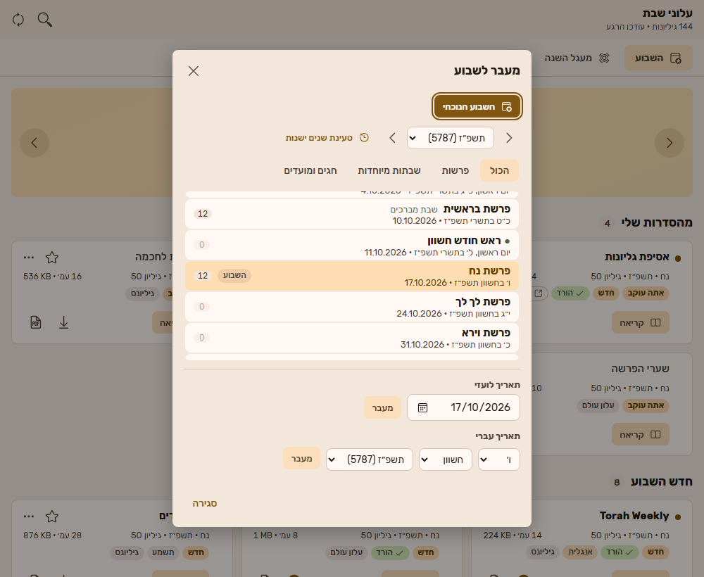

## מעגל השנה

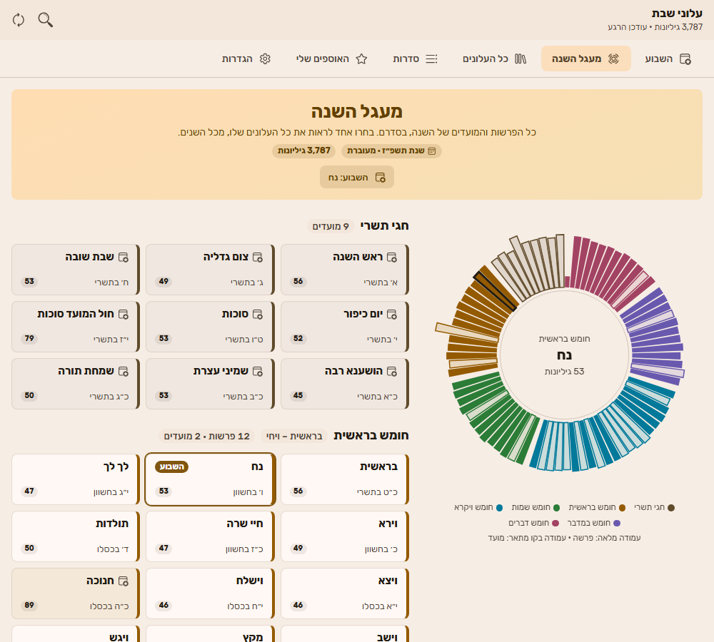

הלשונית **מעגל השנה** מציגה את כל הפרשות והמועדים של השנה בסדרם: קודם חגי תשרי (ראש השנה עד שמחת תורה), ואחריהם חמשת
החומשים, ובכל חומש המועדים במקומם (חנוכה, פורים, פסח, שבועות, תשעה באב…). הסדר הוא של השנה הנוכחית, ולכן בשנה מעוברת פורים
נמצא אחרי ויקרא. על כל אריח: השם, **מספר העלונים מכל השנים**, והתאריך שלו השנה ("י״ד באדר ב׳"). השבוע הנוכחי מסומן.

- **לחיצה על אריח** (או `Enter`) פותחת את **כל העלונים של אותה פרשה או אותו חג, מכל השנים**.
- **הטבעת** (ברוחב של כ-750px ומעלה) היא אותו מעגל כגרף: אורך כל עמודה הוא מספר העלונים; עמודה מלאה היא פרשה, עמודה בקו מתאר
  היא מועד, וכל חלק של השנה בצבע אחר. מעבר עם העכבר מציג במרכז את השם והספירה, ולחיצה פותחת. בצר הטבעת מוסתרת והאריחים בלבד.
- **מקלדת:** חצים עוברים בין האריחים (`←` הבא, `→` קודם, `↑ ↓` שורה), `Home` ו-`End` לתחילה ולסוף, `Enter` פותח. בטבעת — אותם חצים.
- שבת שירה, שבת חזון ושבת נחמו הן תמיד אותה פרשה (בשלח, דברים, ואתחנן), ולכן הן כיתוב על אריח הפרשה ולא אריח נפרד.
- הספירות כוללות את השנים שנטענו. אם יש שנים ישנות שעוד לא נטענו, מתחת לכותרת מופיע "כולל את השנים האחרונות בלבד" עם כפתור טעינה.

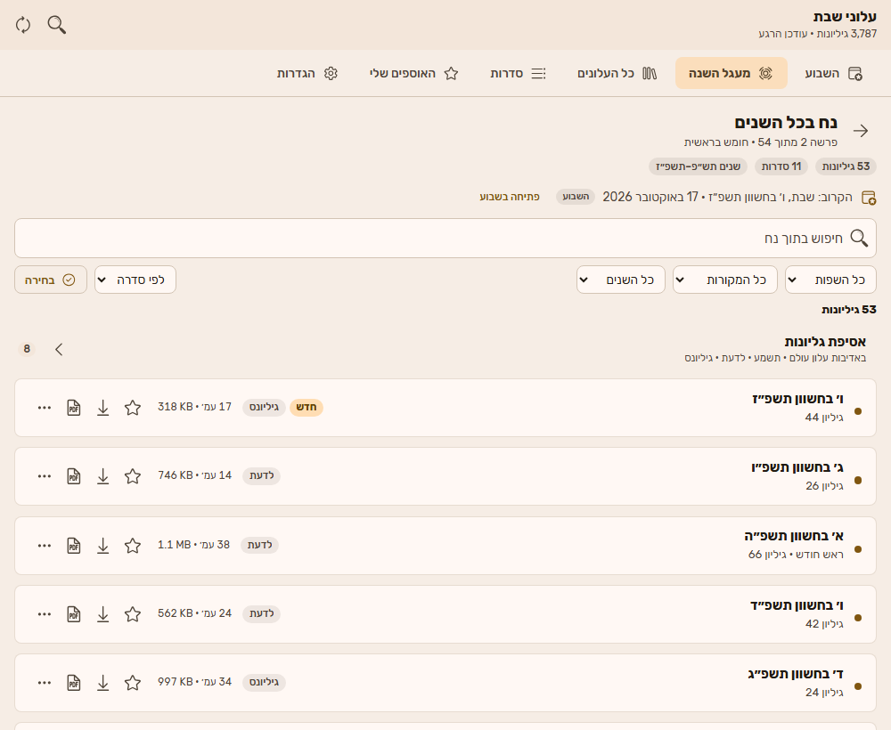

**דף הנושא** ("נח בכל השנים") מציג: כמה גיליונות, סדרות ושנים; מתי הנושא נקרא ("הקרוב: שבת, ו׳ בחשוון…") עם "פתיחה בשבוע";
וכל הגיליונות **מקובצים לפי סדרה**: סדרות שאתם עוקבים אחריהן קודם, אחר כך הסדרות עם הכי הרבה גיליונות. בכותרת כל סדרה: השם,
הקרדיט ("באדיבות לדעת · תשמע"), כמה גיליונות, ולחיצה עליה פותחת את **דף הסדרה המלא**. בתוך סדרה הגיליונות מהחדש לישן, וכותרת הסדרה
נשארת צמודה למעלה בזמן הגלילה.

- **חיפוש בתוך הנושא**, וסינון לפי **שפה, מקור ושנה** (עם ספירה ליד כל ערך). "איפוס" מנקה הכול.
- **קיבוץ**: לפי סדרה (ברירת מחדל) או לפי שנה. הבחירה נשמרת.
- **בחירה** (כמו ב"כל העלונים"): בוחרים כמה גיליונות, או "בחירת כל התוצאות", ומורידים, מדפיסים, מוסיפים למועדפים או לאוסף.
  לחיצה על גיליון פותחת אותו לקריאה, והכפתורים שבכרטיס כרגיל.
- `Esc` מנקה את החיפוש, אחר כך יוצא ממצב בחירה, ואחר כך חוזר למעגל; הכפתור החץ שבראש הדף עושה זאת מיד.

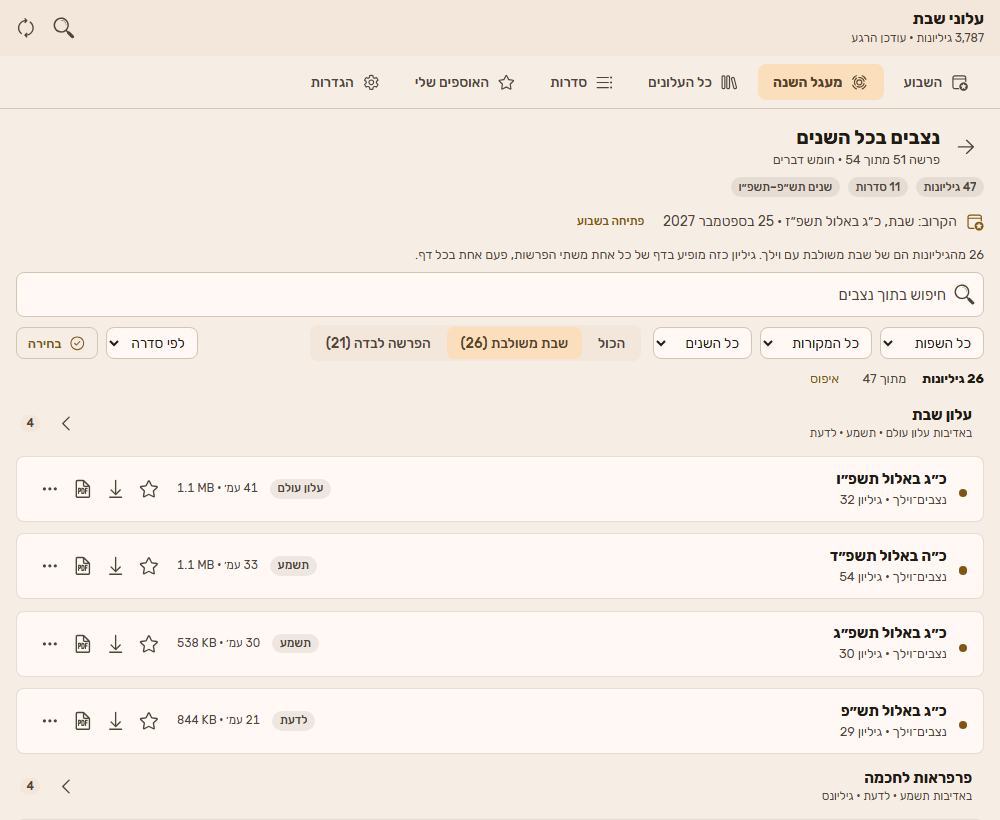

**שבת משולבת.** פרשות כמו ויקהל־פקודי או מטות־מסעי נקראות לפעמים יחד. גיליון של שבת משולבת שייך לשתי הפרשות ומופיע בדף של כל אחת
מהן, **פעם אחת בכל דף**. בדף של פרשה כזו יש בורר: "הכול", "שבת משולבת" (רק הגיליונות שנכתבו לשתיהן יחד), "הפרשה לבדה", והסבר
על כמה מהגיליונות משולבים.

**מועדים.** גם חגים, צומות ושבתות מיוחדות (שקלים, זכור, פרה, החודש, שובה, הגדול…) הם אריחים ודפים. הם נספרים גם בדף הפרשה של אותה
שבת: גיליון של שבת שקלים מופיע בדף "שבת שקלים" וגם בדף הפרשה שנקראה בה. ראש חודש אינו אריח (הוא בכל חודש); גיליון של שבת ראש
חודש נמצא בדף הפרשה שלו.

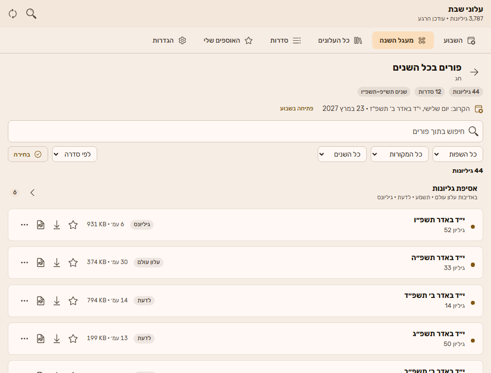

**מכותרת השבוע.** שם הפרשה או החג בכותרת של "השבוע" הוא קישור (עם קו מנוקד), וכך גם תגית השבת המיוחדת וכפתור "נח בכל השנים".
בשבת משולבת כל פרשה היא קישור, והכפתור פותח את הפרשה על "שבת משולבת". "חזרה" מדף כזה מחזירה לשבוע.

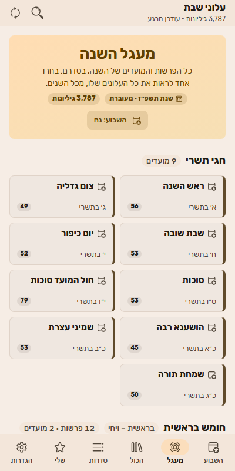

## כל העלונים: חיפוש, מסננים, בחירה

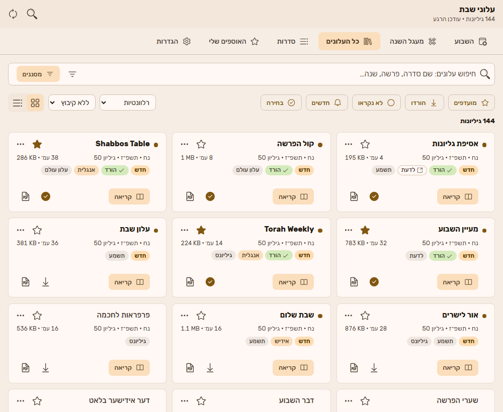

**חיפוש מיידי.** מקלידים שם סדרה, פרשה, שנה, שפה או מקור. `Ctrl+/` (או `/`) ממקד את החיפוש. כשהשדה
ריק מוצגים חיפושים אחרונים וחיפושים שמורים. לדיוק:

| כתבו | מצא |
|------|-----|
| `נח` | כל מה שמתחיל ב"נח" בשם, בפרשה, בשנה… |
| `"אסיפת גליונות"` | הביטוי ברצף |
| `-שבת` | בלי "שבת" |
| `נח OR וירא` | אחת מהשתיים |
| `parasha:נח` · `event:חנוכה` | פרשה (שם מלא) · שבת מיוחדת או חג |
| `year:תשפ״ז` · `year:תשפ״ה-תשפ״ז` | שנה עברית, או טווח |
| `lang:yi` · `source:לדעת` · `circle:בעלזא` · `series:"שם"` | שפה, מקור, חוג, סדרה |

החיפוש הוא בעברית. כתיבה בתעתיק לטיני (`mashiv nefesh`) אינה מומרת; כשאין תוצאות לשאילתה באותיות לטיניות בלבד מוצג רמז "החיפוש הוא בעברית — נסו לכתוב את השם באותיות עבריות". (שמות סדרות שהם עצמם באנגלית נמצאים כרגיל.)

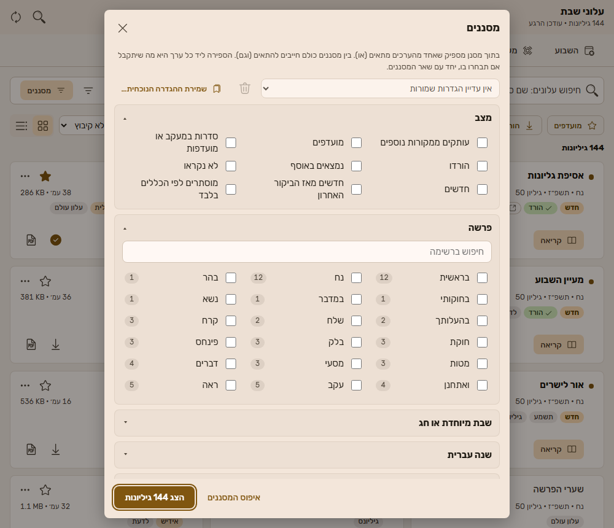

**מסננים.** הכפתור "מסננים" פותח חלון: פרשה, שבת מיוחדת או חג, שנה, שפה, מקור, חוג וסדרה (בחירה
מרובה), טווחי תאריך (לועזי או עברי), שנים, עמודים וגודל, ומצב (מועדפים, הורדו, לא נקראו, חדשים,
חדשים מאז הביקור האחרון, באוסף…). הכלל, כתוב גם בחלון עצמו:

- **בתוך מסנן אחד — "או".** פרשה נח ובראשית = גיליונות של נח *או* של בראשית.
- **בין מסננים שונים, וביניהם לבין הטקסט — "וגם".** פרשה *וגם* שפה *וגם* מקור.
- הספירה ליד כל ערך היא מה שיתקבל אם תבחרו בו, יחד עם שאר המסננים. ערך עם 0 אפור.
- גיליון בלי תאריך אינו עובר טווח תאריכים. שנים שעוד לא נטענו מסומנות, והתוצאות מתעדכנות כשהן מגיעות.

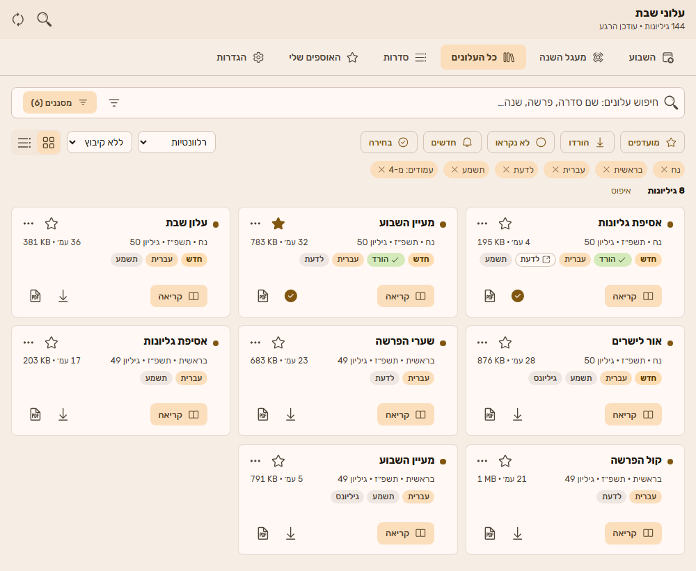

מסננים פעילים מופיעים כתגיות: לחיצה על תגית מסירה אותה. "איפוס" מנקה הכול. אפשר לשמור שילוב
כ"הגדרת חיפוש" בשם, ולחזור אליו מהחלון או משדה החיפוש. המסננים, השאילתה והמיון נשמרים בין הפעלות.

**מיון וקיבוץ.** מיון: רלוונטיות, חדש, תאריך, א-ב, גודל. קיבוץ: לפי שבוע, סדרה, שנה, חוג או שפה.

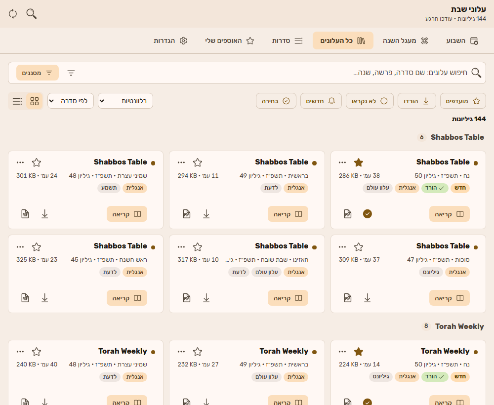

**בחירה מרובה.** "בחירה" מציג תיבות סימון בכרטיסים; בשורה שבתחתית: הורדה, מועדפים, הוספה לאוסף,
הדפסה (באוצריא 0.9.99 ומעלה: מסך ההדפסה של אוצריא, ברצף), ובתפריט ⋯: סימון נקרא/לא נקרא, הסרה ממועדפים, הסתרת הסדרות והעתקה
כטקסט (שורה לגיליון, עם קישור). "בחירת כל התוצאות (N)" בוחרת את כל מה שמסונן כרגע (עד 2,000), והמספר תמיד משקף את התוצאות
הנוכחיות. הבחירה היא לפי גיליון: כשמשנים חיפוש או מסנן, גיליון שנבחר ויצא מהתוצאות מוסר מהבחירה (כך "נבחרו N" והפעולות חלים רק על מה
שנראה), ואלה שנשארו בתוצאות נשארים נבחרים. מעבר ללשונית אחרת יוצא ממצב בחירה.

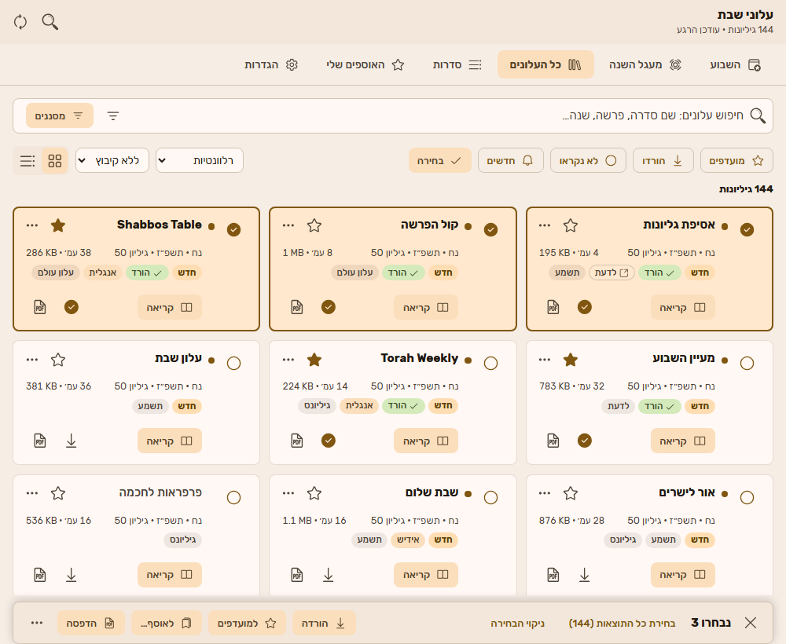

## קריאה, הורדה והדפסה

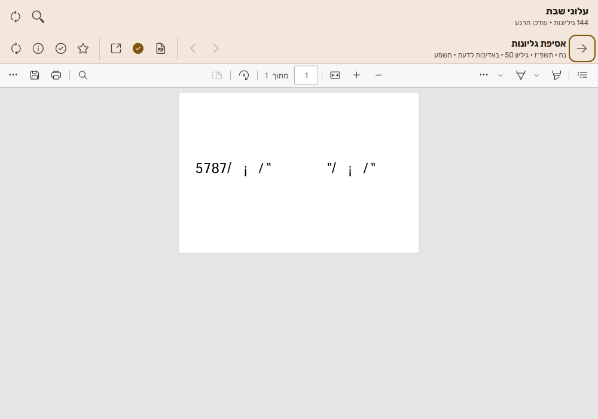

לחיצה על גיליון פותחת אותו לקריאה בצפיין הפנימי, עם הקודם והבא לפי הרשימה. **הורדה** שומרת אותו
בתיקייה שבחרתם (לפי שנה וסדרה) לקריאה גם בלי רשת; היא נפרדת מהקריאה.

- **באוצריא 0.9.99 ומעלה** הקריאה אינה מורידה דבר, ו"הדפסה" (בסרגל הצפיין, בכרטיס, או `P`) פותחת את **מסך ההדפסה של
  אוצריא עצמה**: טווח עמודים, תצוגה מקדימה, פריסה, ובסוף דיאלוג ההדפסה של המערכת. בבחירה מרובה "הדפסה ברצף" פותחת
  מסך אחד בכל פעם ועוברת לגיליון הבא כשסיימתם; אם ביטלתם גיליון, הרצף נעצר ו"הדפס הבא" ממשיך. אם אוצריא דורשת לחיצה (אצל חלק
  מהגרסאות), מוצג כפתור "הדפסה" ויש ללחוץ עליו.
- **בגרסה ישנה יותר** הקריאה מורידה זמנית לתיקיית `_קריאה`, וההדפסה נעשית מסרגל הצפיין או מהקורא של אוצריא
  (התוסף מנחה).
- "פתח בקורא של אוצריא" מציג התקדמות ("מרענן את הספרייה…") ואפשר לבטל. אם הספרייה של אוצריא עוד לא נטענה, אחרי כמה שניות
  מוצגת הודעה ברורה ו"ניסיון חוזר", ולא המתנה ארוכה בשקט.
- `Esc` או "חזרה לרשימה" סוגרים את הצפיין, והמיקוד חוזר לכרטיס שקראתם אחרון. אחרי לחיצה על המסמך עצמו `Esc` נקלט בתוך המסמך (הדפדפן הפנימי): חזרה בלחיצה על החץ.
- אם המסמך אינו מוצג, "הצגה חלופית" בסרגל מחליפה את שיטת התצוגה.
- אם הקובץ חסום או נכשל — "פתח באתר המקור". כל כשל נושא קוד ("קוד: …") שאפשר לצרף לדיווח.

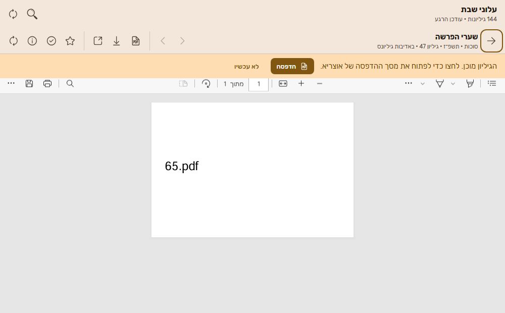

## פרטי גיליון וסדרות

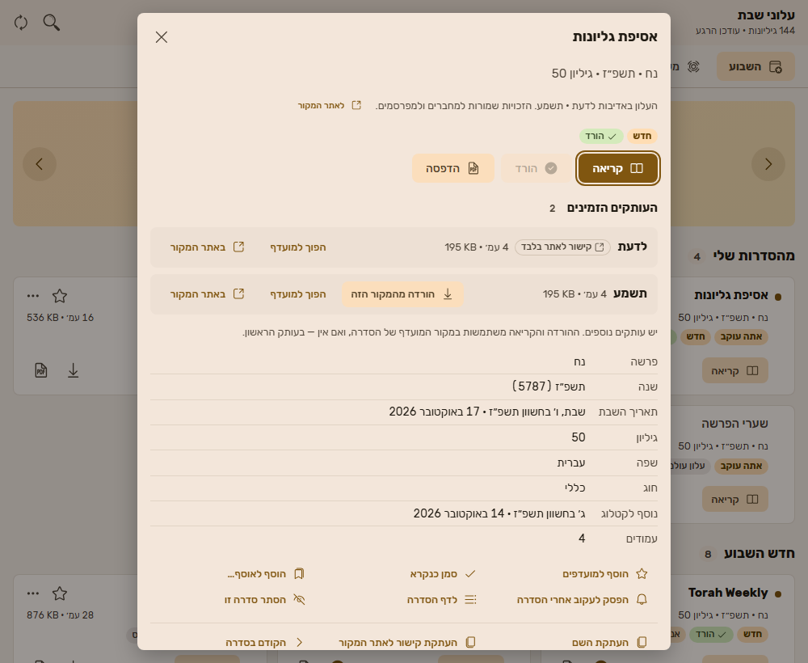

פרטי הגיליון: כל העותקים והמקורות, בחירת מקור מועדף, **הקודם והבא בסדרה**, עוד גיליונות בסדרה,
**אותה פרשה בשנים אחרות**, והעתקת שם או קישור לאתר המקור. מדף סדרה אפשר לעקוב, להשתיק, לבחור
מקור מועדף ולעיין לפי שנה עברית.

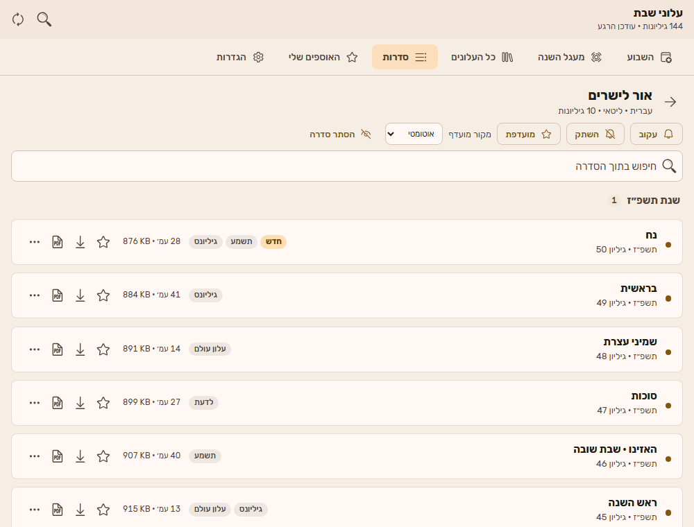

## האוספים שלי והיסטוריה

מועדפים, רשימות קריאה, "אוסף שבת" (בוחרים, מורידים הכול ופותחים), הורדות, ו**היסטוריה**: מה נפתח, נקרא,
הורד והודפס, עם המשך קריאה, מחיקת פריט בודד וניקוי. הכול נשמר במכשיר בלבד; בהגדרות אפשר לכבות את
ההיסטוריה. ייצוא רשימה כטקסט: כפתור "ייצוא כטקסט" ברשימה.

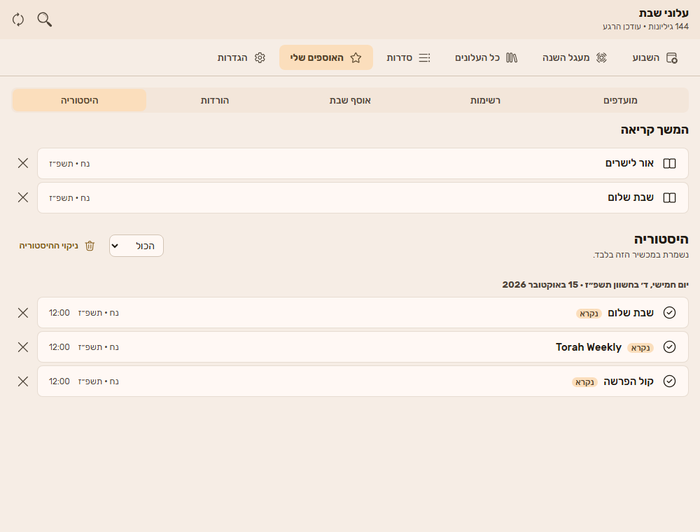

## הגדרות

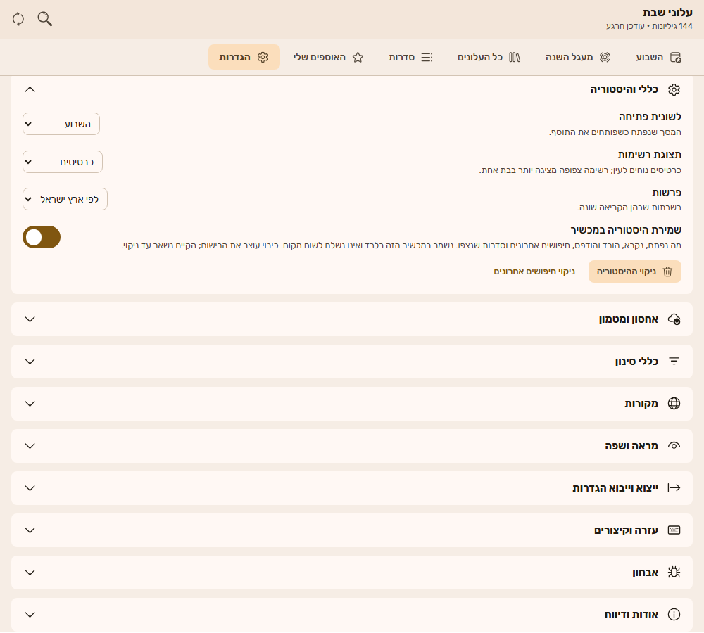

- **כללי והיסטוריה:** לשונית פתיחה, תצוגת רשימות, פרשות לפי ארץ ישראל או חוץ לארץ, היסטוריה.
- **אחסון ומטמון:** מטמון הקטלוג, הקבצים שהורדו לפי תאריך, ו**מחיקת קבצים ישנים** (30–365 ימים) שאינה
  נוגעת במועדפים ובגיליונות שבאוספים (מוצג מראש כמה יימחקו), וקבצי קריאה זמניים.

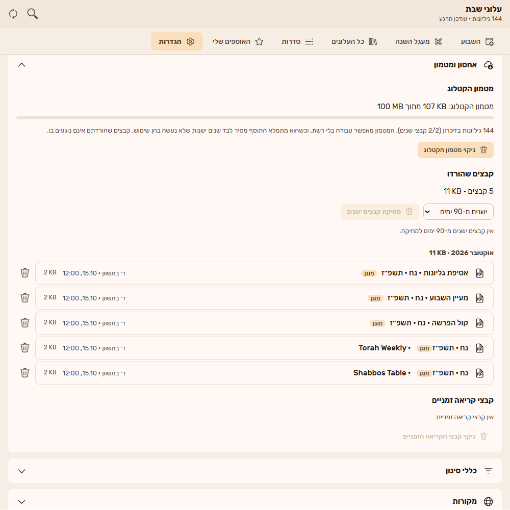

- **כללי סינון:** להסתיר או להתיר סדרות, מקורות, שפות וחוגים, עם סימולציה ("הכלל יסתיר 312 גיליונות").
- **עזרה וקיצורים:** תחביר החיפוש, סמנטיקת המסננים וקיצורי המקלדת (`?` פותח אותם בכל מקום).
- **אבחון:** גרסת אוצריא והיכולות החדשות (זמינות או לא, ולמה), מצב הקטלוג (גילו והסנכרון האחרון), הקבצים, זמני הפעלה וחיפוש, גודל האחסון,
  אזהרות ושגיאות לפי קוד, ויומן עם העתקה מנוקה (בלי נתיבים) לדיווח. פירוט לבודקים: `DEBUGGING.md`.

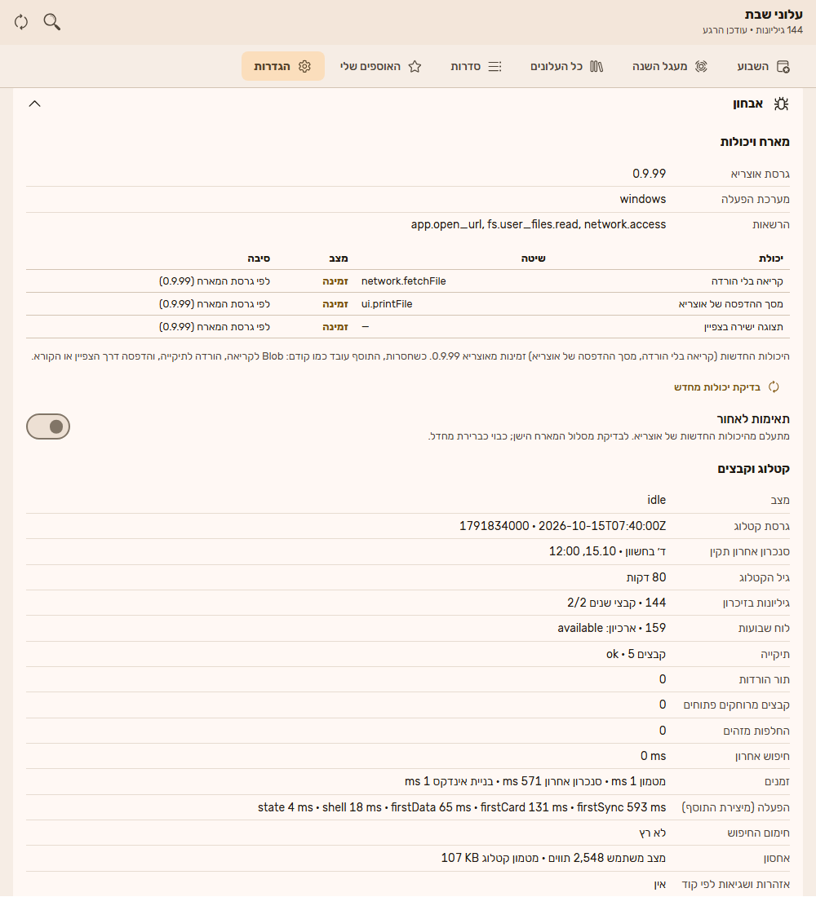

## בטלפון, בהגדלה ובאנגלית

התוסף מותאם לרוחב צר (400px), להגדלת תצוגה (בהגדרות ← מראה) ולאנגלית (לפי שפת אוצריא או לפי בחירה).

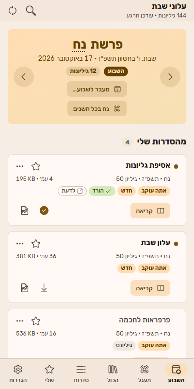 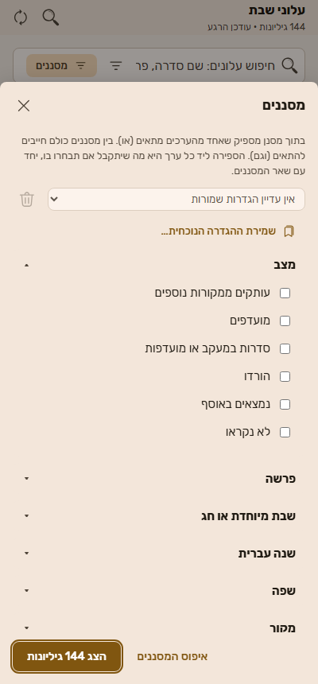 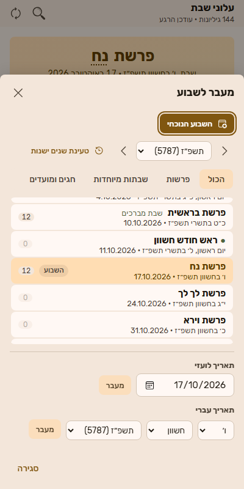

## קיצורי מקלדת

`Ctrl+/` חיפוש · `/` חיפוש (כשאין שדה פעיל) · `Esc` סגירה, חזרה, ניקוי · חצים בין כרטיסים · `Enter`
קריאה · `D` הורדה · `P` הדפסה · `S` מועדף · `I` פרטים · `?` כל הקיצורים.

## הפעלה ראשונה

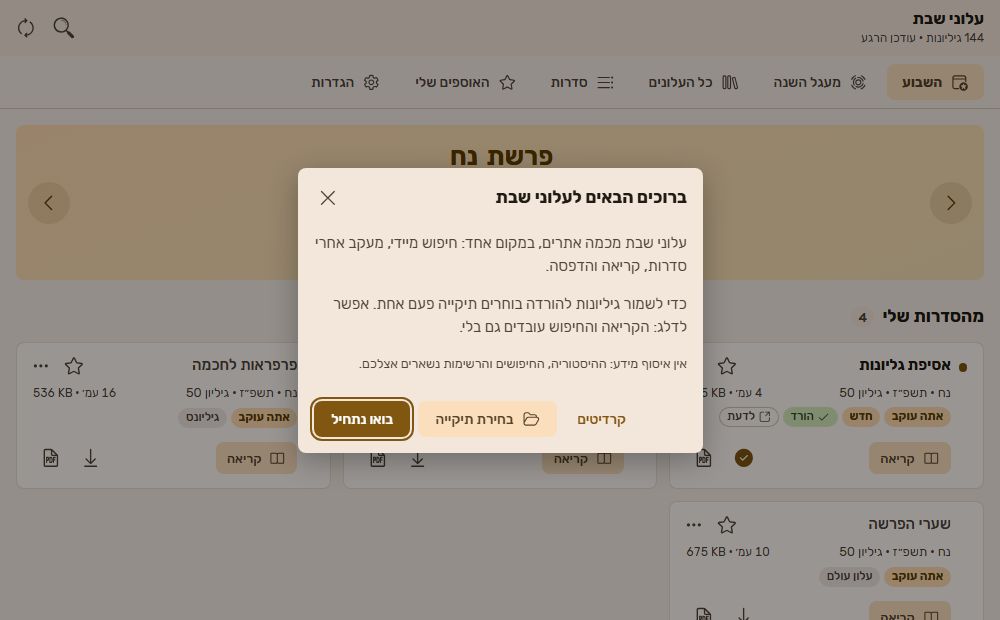

בפעם הראשונה מוצג חלון קצר: אפשר לבחור תיקייה לשמירת גיליונות (לא חובה) ולראות את הקרדיטים.
